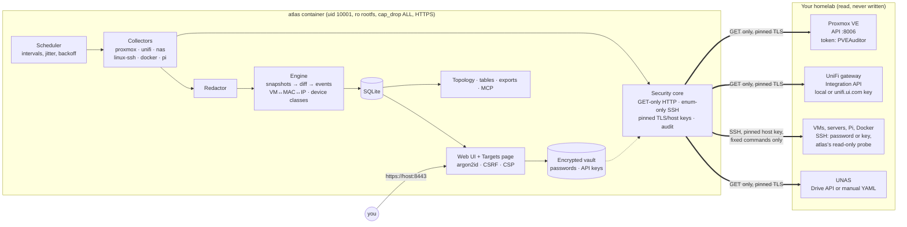

# Homelab-Docs (`atlas`)

[](https://github.com/FouadHellal/Homelab-Docs/actions/workflows/ci.yml)
[](https://github.com/FouadHellal/Homelab-Docs/actions/workflows/image.yml)
[](LICENSE)

atlas documents your homelab for you, and only reads. You add your Proxmox, your UniFi
gateway and your VMs on a web page. atlas then:

- logs in to each of them;
- records what runs inside: OS, **every systemd service**, processes, listening ports,
  Docker containers, packages, disks, users and cron jobs. It recognises about 70 common apps
  (Pi-hole, Home Assistant, Jellyfin, NetBox…);
- draws your Proxmox cluster the way you think of it: each node, its bridges, and the VMs and
  LXCs on it;
- finds every VM's IP and switch port through UniFi;
- links everything into a topology;
- keeps tables (services with CSV export, IPs, VLANs, ports), a change history, and exports
  in Markdown, MkDocs, JSON, CSV and Mermaid;
- serves a read-only MCP server so AI assistants can answer questions like *"what changed on
  docker01 this week?"*.

It never changes anything on your machines. See [SECURITY.md](SECURITY.md).

Status: beta. It runs on a real homelab (two Proxmox nodes, UniFi, a dozen VMs and Pis), and
every change is tested against a synthetic demo lab. Read the
[known limitations](SECURITY.md#known-limitations-read-these). The in-app guide is at `/docs`.

- [Deploy](#deploy) · [First login](#first-login) · [Add your homelab](#add-your-homelab) ·
  [Day-to-day](#day-to-day) · [Troubleshooting](#troubleshooting) · [Architecture](#architecture) ·
  [Try the demo](#try-it-without-a-homelab) · [Development](#development) ·
  [Contributing](CONTRIBUTING.md) · [Changelog](CHANGELOG.md)

## Deploy

> Deploying with Claude Code on the VM? Paste the prompt from [docs/DEPLOY-WITH-CLAUDE-CODE.md](docs/DEPLOY-WITH-CLAUDE-CODE.md).

**You need:**
- a small Linux VM or LXC on your LAN, e.g. Debian 12/13 or Ubuntu 22.04/24.04 with 1 vCPU,
  1 GB RAM and 10 GB disk;
- [Docker Engine](https://docs.docker.com/engine/install/) with the compose plugin;
- network reach to your Proxmox (port 8006), your UniFi gateway (443) and your VMs (SSH, 22).

```bash
git clone https://github.com/FouadHellal/Homelab-Docs.git    # private repo: use your GitHub login / token
cd Homelab-Docs
sudo ./deploy/atlas.sh install
```

The installer:
1. creates `/opt/atlas` with the compose files, a `.env` and a `secrets/` folder;
2. generates `secrets/atlas_master_key`, which encrypts the passwords and API keys you will type in the UI;
3. detects this machine's IPs and hostname, which become the names atlas answers to and are put in its HTTPS certificate;
4. gets the image: it pulls `ghcr.io/fouadhellal/homelab-docs`, and if that fails (the package is private and you aren't logged in) it **builds the image from your clone** (a few minutes the first time);
5. asks for a **username and password**: that's your atlas login;
6. starts atlas and prints the address, e.g. `https://192.168.1.50:8443`, plus the certificate fingerprint.

To pull the image instead of building it, log in once with a GitHub token that has
`read:packages`, then run the installer:

```bash
echo "$GITHUB_TOKEN" | sudo docker login ghcr.io -u <your-github-user> --password-stdin
```

## First login

- Open the printed address. Your browser warns about the self-signed certificate once: compare the fingerprint the installer printed, then accept it.
- Log in with the username and password you chose during install.
- **There is no default password.** If you skipped account creation (`install --no-user`), the first visit shows a **setup page**. It asks for a one-time token from `sudo ./deploy/atlas.sh logs`.

Manage accounts from the clone at any time:

```bash
sudo ./deploy/atlas.sh user add alice      # another account (asks for the password)
sudo ./deploy/atlas.sh user passwd admin   # forgot it? set a new one
```

## Add your homelab

Open **Targets** in the menu.

### 1. Proxmox: every VM and container, automatically

- **Where:** Targets → Proxmox VE → **+ add**.
- **Address:** the node's IP, e.g. `192.168.1.10`.
- **Token:** a read-only API token. Create it on a Proxmox node:
  ```bash
  pveum user add atlas@pve
  pveum acl modify / --users atlas@pve --roles PVEAuditor
  pveum user token add atlas@pve collector --privsep 1      # copy the secret it prints
  pveum acl modify / --tokens 'atlas@pve!collector' --roles PVEAuditor
  ```
  Paste it as `atlas@pve!collector=<secret>`.
- **Save:** click **Fetch certificate**, check the fingerprint, tick the box, save. Then **Test connection**.

### 2. UniFi: devices, clients, VLANs, and the IPs of your VMs

- **Where:** Targets → UniFi gateway → **+ add**.
- **Choose the kind of key you have:**

  | Your key comes from | Choose | Then |
  |---|---|---|
  | The **UniFi Network app** on the gateway (its integrations / API key settings) | **Local key** (recommended, no internet) | Gateway IP, the key, **Fetch certificate** → tick → Save |
  | **unifi.ui.com → Settings → API Keys** (Site Manager) | **unifi.ui.com key** | The key → **Find my consoles** → pick your gateway → Save |

- **Test:** press **Test connection**, then **Scan**.

The cloud option goes through Ubiquiti's connector at api.ui.com (max 100 requests per minute;
atlas paces itself). atlas only ever sends **GET** requests, whatever rights the key has, and
never reads Wi-Fi passwords.

**What UniFi adds:**
- Your switches, access points and clients, and which port or AP each one hangs off.
- **The IP, VLAN and switch of every Proxmox VM**, matched by MAC address. This works even without the QEMU guest agent.
- **Unknown devices**: anything on the network you haven't added. atlas sorts them:
  - VMs, servers, Raspberry Pis and NAS are listed, with an **Add as target** button that pre-fills the VM form;
  - phones, TVs and IoT are hidden behind *show everything*.

### 3. VMs, servers, Raspberry Pis: what runs inside

1. Go to Targets → Machines → **+ add a VM / host**.
2. Enter the IP and pick what to collect: **Linux** (services, ports, packages, users, disks, cron), **Docker** (containers, images, networks, volumes, compose projects), and **Raspberry Pi** where it applies.
3. Choose how atlas logs in:

   | Login | What you do | Notes |
   |---|---|---|
   | **Password** (simplest) | Type the SSH username and password | Nothing is installed. Tick *use for sudo* to get Docker and process details. |
   | **SSH key** | Copy the key line shown on the page into `~/.ssh/authorized_keys` of that user | Nothing is installed; no password stored. |
   | **SSH key + installed probe** (strictest) | Install the small read-only probe from `docs/targets/` ([SETUP-TARGETS](docs/SETUP-TARGETS.md) §2) | Read-only is enforced by the VM itself. |

4. Click **Fetch host key**. Check the fingerprint with `ssh-keygen -lf /etc/ssh/ssh_host_ed25519_key.pub` on the VM, tick the box, and save.
5. Press **Test login**, then **Scan**.

Passwords and keys are stored encrypted and are never shown again. `root` logins are refused:
use a normal user, with sudo if you want Docker details.

**Everything that runs, not only Docker.** A machine scan lists every systemd service (running,
stopped or failed), the running processes, listening ports and timers. atlas then recognises about
70 common apps from those, so a Pi-hole installed with its script shows up as Pi-hole, next to
Unbound, Tailscale and the rest. Add the Pi-hole (and any other box) as a machine to see this.
Process command lines are redacted before they are stored.

**Proxmox VMs without an API token.** Add a Proxmox node as a machine (type
`proxmox-node`, with sudo). atlas reads `/etc/pve` over SSH: cluster members, every guest's
configuration (cores, memory, disks, NICs, bridge, VLAN), and what runs on that node.
**One node is enough to see the whole cluster.** Add every node to also see each guest's running
state. It never reads `/etc/pve/priv`. If you also add an API token (section 1), the API's data
is shown and SSH stays as a fallback.

### What you get

| Page | What's there |
|---|---|
| **Dashboard** | Clickable tiles, your Proxmox nodes with their guests, a card per machine with the apps found on it (filter by kind, search), **Needs attention** (failed or never-scanned targets, with the reason), devices seen on the network but not documented yet, recent changes, "Scan now" |
| **Topology** | **Proxmox**: one box per node, holding the node, its bridges, and its VMs and LXCs. Each guest is wired to the bridge its NIC uses, with traffic pulses on running guests. Summary cards show guests and the vCPU and RAM allocated. **Network**: gateway → switches → APs → hosts. **VLANs**. Hover highlights the path, click shows details, **right-click** gives actions (open, web UI, scan this machine, copy IP/MAC/SSH command, show only this, containers), plus search, three layouts and PNG export. Keys: `/` `F` `R` `C` |
| **Services** | Every systemd unit and Docker container on every machine in one table. Filter by machine, state (running / failed / stopped), type and text, then **Export CSV** |
| **Apps** | Recognised apps by category (Pi-hole, Unbound, Tailscale, Home Assistant, Jellyfin, NetBox, Grafana…) and where they run, with a link to their web UI |
| **Inventory** | Every machine. Open one for OS, network, ports, a **Running** panel (services, containers, processes, ports, timers), disks, users, notes and history |
| **IPs** | One row per device with all its addresses, MACs and networks. Link-local and Docker-bridge addresses are hidden until you ask for them |
| **VLANs / Ports** | Searchable tables |
| **Changes** | Typed events: port opened, image updated, container restarted, new device on a VLAN, VM not backed up… |
| **Unknown** | Devices on the network you haven't added, infrastructure first |
| **Targets** | Add and edit machines, Proxmox and UniFi. Each row shows its **last scan** (ok / partial / failed and why / not scanned yet) |
| **Docs** | The in-app guide. **Ctrl+K** jumps to any page, machine or app |

Scans run on their own: UniFi and Proxmox every 15 min, machines hourly. A new target is
scanned as soon as you save it. **Scan now** (dashboard) and **Scan** (per target) are queued,
so pressing Scan on five machines scans all five, one after the other.

## Day-to-day

```bash
sudo atlas update             # new version: git pull, DB backup, new image, restart
sudo atlas status             # health, address, certificate fingerprint
sudo atlas logs               # follow the logs
sudo atlas version            # running version
sudo atlas backup             # DB + config to a .tar.gz
sudo atlas uninstall          # stop and remove containers (add --purge to delete data)
```

`atlas` is a shortcut to `deploy/atlas.sh` that `install` and `update` put in `/usr/local/bin`.

**Updating keeps everything you entered.** `sudo atlas update`:

1. fast-forwards the clone (`git pull --ff-only`), running git as the clone's owner so your
   GitHub login works with a private repository. It never discards local edits. If the pull
   fails, the update **stops** and says why, instead of reinstalling the old code;
2. writes a backup to `/opt/atlas/backups/pre-update-<date>.tar.gz` (the last 5 are kept);
3. pulls the new image (or rebuilds it if you installed with `--build`);
4. recreates the container and prints `updated: atlas 0.2.0 -> atlas 0.3.1`. If the version
   did not change, it says so.

Then reload the page with **Ctrl+F5**. `sudo atlas version` shows the running version and the
commit of your clone.

Your targets, stored passwords and keys, accounts, notes and history live in the data volume and
in `/opt/atlas` (`.env`, `secrets/`, `config/`). An update never deletes them. Database changes
are migrated automatically on start. Options: `--no-pull` (keep the code), `--no-backup`, `--build`.

**Coming from the first version** (no `atlas` shortcut yet), run once in your clone:

```bash
git pull && sudo ./deploy/atlas.sh update
```

**Back up `/opt/atlas/secrets/atlas_master_key` separately.** Without it the stored passwords
and keys can't be decrypted. Your inventory survives, but you would re-enter the credentials.
The backup archive deliberately leaves the key out.

**Settings** live in `/opt/atlas/.env`; after editing, run `sudo ./deploy/atlas.sh start`.

| Setting | Meaning |
|---|---|
| `ATLAS_HOSTS` | Names/IPs you open atlas with, comma-separated. Add your DNS name here. |
| `ATLAS_PORT` | Published port (default `8443`) |
| `ATLAS_INTERVAL_UNIFI`, `…_PROXMOX`, `…_LINUX_SSH`, `…_DOCKER` | Scan intervals in seconds; `0` disables one |
| `ATLAS_SNAPSHOT_DAYS` | How long detailed snapshots are kept (default 90; change history is kept forever) |
| `ATLAS_MODE=proxy` | Run behind your own TLS reverse proxy instead (HTTP on 127.0.0.1:8080, see [docs/DEPLOY.md](docs/DEPLOY.md)) |

**MCP for AI assistants (optional):** `docker compose --project-directory /opt/atlas --profile mcp up -d`.
The bearer token is in `/opt/atlas/secrets/mcp_token`. See [docs/DEPLOY.md §6](docs/DEPLOY.md).

## Troubleshooting

| Symptom | Fix |
|---|---|
| Login page reloads without logging in | Use **https://**, not http (the session cookie is HTTPS-only). |
| "Invalid host header" | Add the name/IP you typed to `ATLAS_HOSTS` in `/opt/atlas/.env`, then `atlas.sh start`. |
| `install` builds instead of pulling | The GHCR package is private: `docker login ghcr.io` first, or keep building from the clone. |
| VM **Test login** fails: *authentication refused* | Wrong username/password, or SSH password login is disabled on the VM (`PasswordAuthentication no`). Use the SSH key option. |
| VM scan is *partial* | No sudo, so Docker details, port owners and root crontabs are missing. Tick *use for sudo*, or give the user sudo. |
| UniFi cloud: *the key was refused* | The key is from unifi.ui.com but was entered as Local, or the other way round. Pick the other option. |
| UniFi local: certificate error | Fetch the certificate again (the gateway's certificate changed after an update) and confirm it. |
| Forgot the password | `sudo atlas user passwd <name>` |
| Topology/dashboard shows no Proxmox nodes or VMs | Add a Proxmox node as `proxmox-node` with sudo, or fix the token: **Test connection** says "sees no nodes" when the *token itself* lacks the PVEAuditor role (privilege separation). Run the last `pveum acl modify … --tokens` line of section 1. |
| `sudo atlas update` changed nothing | Run `sudo atlas version`. If the commit is old, `git pull` failed (often a private repo: root has no GitHub login). Run `git -C <your clone> pull` as your own user, then `sudo atlas update --no-pull`, then Ctrl+F5 in the browser. |
| A machine never gets documented | Look at its **Last scan** on Targets. *Not scanned yet*: press Scan. *Failed*: open the line for the reason (wrong password, `PasswordAuthentication no`, host key, timeout). |
| A Pi-hole (or other box) shows no services | It isn't a target yet: add it as a machine, then **Scan**. |

## Architecture



[docs/ARCHITECTURE.md](docs/ARCHITECTURE.md) covers trust boundaries, scan sequence and the data model.

## Try it without a homelab

```bash
uv sync
uv run atlas scan --lab demo:A --fresh && uv run atlas scan --lab demo:B
uv run atlas serve --lab demo --schedule    # http://127.0.0.1:8080, login in data/demo-lab/demo-login.txt
```

| Command | What it shows |
|---|---|
| `uv run atlas diff --lab demo` | 59 typed change events between the two demo states |
| `uv run atlas unknown --lab demo` | Devices nothing explains |
| `uv run atlas export mkdocs --sanitize --lab demo` | A shareable, pseudonymised MkDocs site |
| `uv run atlas mcp --lab demo` | Read-only MCP server (stdio) |

## Development

```bash
uv sync && uv run pre-commit install
uv run poe check                  # ruff, mypy --strict, pytest (~820 tests), gitleaks
uv run atlas selftest security    # every read-only/redaction guard, offline
```

| Doc | What's in it |
|---|---|
| [docs/DEPLOY.md](docs/DEPLOY.md) | Deployment details: reverse proxy, MCP, backups |
| [docs/SETUP-TARGETS.md](docs/SETUP-TARGETS.md) | Least-privilege accounts and the strict key + probe setup |
| [docs/SPEC.md](docs/SPEC.md) | Scope, entities, events, interfaces |
| [docs/DECISIONS.md](docs/DECISIONS.md) | ADRs, with vendor API facts and their sources |
| [docs/THREAT-MODEL.md](docs/THREAT-MODEL.md) · [docs/SECURITY-REVIEW.md](docs/SECURITY-REVIEW.md) | Threats and the latest review |
| [docs/targets/](docs/targets/) | The read-only probe, gate and sudoers files |

## License

[MIT](LICENSE). The topology's node → bridge → guest "flow" view was inspired by
[ProxMenux](https://github.com/MacRimi/ProxMenux)'s network flow. It is our own implementation:
no ProxMenux code is included.
