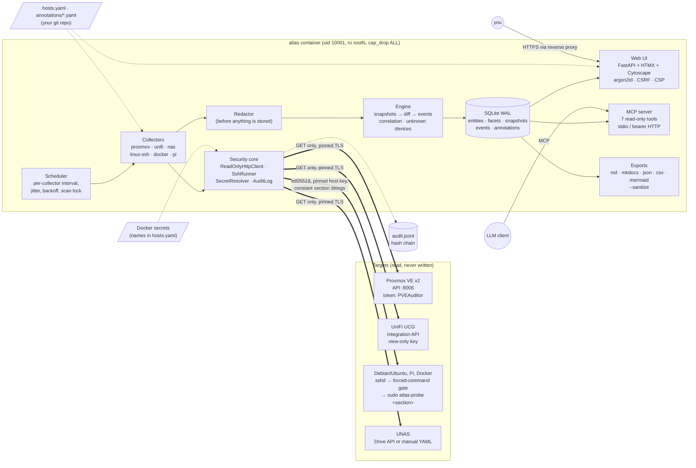

# Homelab-Docs (`atlas`)

Read-only, agentless auto-discovery and documentation for a Proxmox + UniFi + Docker homelab.
atlas pulls facts from the Proxmox API, the UniFi gateway's local Integration API and SSH
probes on Debian/Ubuntu hosts. It keeps a change-tracked inventory and offers several ways to
use it:
- a web UI with topology views;
- exports in Markdown, MkDocs, JSON, CSV and Mermaid, with `--sanitize` for screenshots;
- a read-only MCP server for questions like *"what changed on docker01 this week?"*.

It never changes a target. That is enforced twice: in code (GET-only HTTP and an allowlisted
SSH runner) and on each target (least-privilege accounts). See [SECURITY.md](SECURITY.md).

Status: **M7**. All collectors, UI, exports, MCP, scheduler, container image and CI are done.
It is developed and tested against a synthetic demo lab, and the first run against real
hardware is still pending ([SECURITY.md → Known limitations](SECURITY.md#known-limitations-read-these)).

## Architecture



More detail: [docs/ARCHITECTURE.md](docs/ARCHITECTURE.md) has the trust boundaries, scan
sequence, SSH enforcement and data model.

## Try it (synthetic demo lab, no real targets)

```bash
uv sync
uv run atlas scan --lab demo:A --fresh
uv run atlas scan --lab demo:B
uv run atlas diff --lab demo                      # 59 typed change events
uv run atlas serve --lab demo --schedule          # http://127.0.0.1:8080, login in data/demo-lab/demo-login.txt
```

| Command | What it shows |
|---|---|
| `uv run atlas unknown --lab demo` | Devices on the network that nothing explains |
| `uv run atlas doctor --lab demo:A` | An outdated probe, an unreachable host, Proxmox privilege check |
| `uv run atlas export mkdocs --sanitize --lab demo` | `exports/mkdocs-sanitized/` (also `json`, `csv`, `md`, `mermaid`) |
| `uv run atlas mcp --lab demo` | MCP over stdio; add `--http` for Streamable HTTP with a bearer token |

MCP client config (stdio):
```json
{ "mcpServers": { "atlas": { "command": "uv", "args": ["run", "--directory", "/path/to/Homelab-Docs", "atlas", "mcp", "--lab", "demo"] } } }
```
Tools: `list_hosts`, `get_host`, `list_containers`, `search_ip`, `find_service`, `what_changed`,
`list_unknown_devices`. None of them can trigger a scan or write anything.

## Run it for real

1. **Targets:** [docs/SETUP-TARGETS.md](docs/SETUP-TARGETS.md) covers the least-privilege accounts:
   a PVEAuditor token, a view-only UniFi key, and an SSH forced-command probe with exact-argv sudo.
2. **Deploy:** [docs/DEPLOY.md](docs/DEPLOY.md) covers `docker compose` on a small VM/LXC behind
   your TLS reverse proxy (Caddy, Traefik and nginx examples).
3. **Check and start:**
   ```bash
   docker compose run --rm atlas atlas user add admin
   docker compose run --rm atlas atlas doctor --live
   docker compose up -d
   ```

## What it collects

| Source | How | What |
|---|---|---|
| Proxmox VE | API token, PVEAuditor | cluster, nodes, VMs/LXCs, config, guest-agent IPs/OS, storage, networks/SDN, HA, backup jobs, **guests not backed up** |
| UniFi (UCG) | Integration API, `X-API-KEY` | devices and uplink tree, ports, clients (wired/wireless, VLAN), networks/VLANs, SSIDs (never passphrases), firewall zones/policies |
| Debian/Ubuntu, Pi | SSH probe | OS, kernel, interfaces/addresses/routes, listening ports with processes, systemd units, cron, users (no hashes), key packages, storage, Pi temperature/throttling |
| Docker | SSH probe (sudo, no docker group) | containers, images and digests, ports, networks, volumes, compose projects, health, restarts, env **names only** |
| UNAS | Drive API (opt-in) or manual YAML | pools, disks, shares |

Changes between scans become typed events, for example:
- `port.opened`, `image.updated`, `container.restarted`;
- `device.new_on_vlan`, `firewall.policy_changed`;
- `guest.not_backed_up`, `host.unreachable`.

## Development

```bash
uv sync && uv run pre-commit install
uv run poe check                  # ruff, mypy --strict, pytest (~670 tests), gitleaks
uv run atlas selftest security    # every read-only/redaction guard, offline
```

| Doc | What's in it |
|---|---|
| [docs/SPEC.md](docs/SPEC.md) | Scope, entities, events, interfaces, milestones |
| [docs/DECISIONS.md](docs/DECISIONS.md) | ADRs, with vendor API facts and their sources |
| [docs/THREAT-MODEL.md](docs/THREAT-MODEL.md) | STRIDE per trust boundary |
| [docs/targets/](docs/targets/) | Generated probe, gate and sudoers files (`atlas targets render`) |
| [CLAUDE.md](CLAUDE.md) | Working rules for AI-assisted development in this repo |
