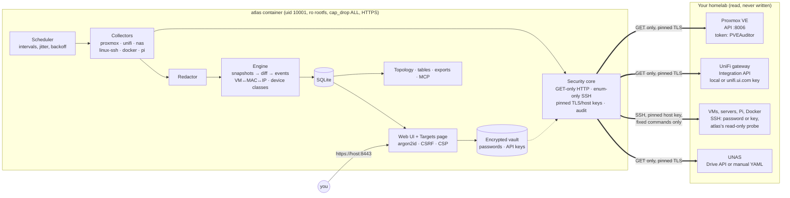

# Homelab-Docs (`atlas`)

atlas documents your homelab for you, and only reads. You add your Proxmox, your UniFi
gateway and your VMs on a web page. atlas then:

- logs in to each of them;
- records what runs inside (OS, services, listening ports, Docker containers, packages,
  disks, users, cron jobs);
- finds every VM's IP and switch port through UniFi;
- links everything into a topology;
- keeps tables (IPs, VLANs, ports), a change history, and exports in Markdown, MkDocs, JSON,
  CSV and Mermaid;
- serves a read-only MCP server so AI assistants can answer questions like *"what changed on
  docker01 this week?"*.

It never changes anything on your machines. See [SECURITY.md](SECURITY.md).

Status: feature-complete and tested against a synthetic demo lab. **The first run against real
hardware is still pending**
([known limitations](SECURITY.md#known-limitations-read-these)).

- [Deploy](#deploy) · [First login](#first-login) · [Add your homelab](#add-your-homelab) ·
  [Day-to-day](#day-to-day) · [Troubleshooting](#troubleshooting) · [Architecture](#architecture) ·
  [Try the demo](#try-it-without-a-homelab) · [Development](#development)

## Deploy

> Deploying with Claude Code on the VM? Paste the prompt from [docs/DEPLOY-WITH-CLAUDE-CODE.md](docs/DEPLOY-WITH-CLAUDE-CODE.md).

**You need:**
- a small Linux VM or LXC on your LAN, e.g. Debian 12/13 or Ubuntu 22.04/24.04 with 1 vCPU,
  1 GB RAM and 10 GB disk;
- [Docker Engine](https://docs.docker.com/engine/install/) with the compose plugin;
- network reach to your Proxmox (port 8006), your UniFi gateway (443) and your VMs (SSH, 22).

```bash
git clone https://github.com/FouadHellal/Homelab-Docs.git    # private repo: use your GitHub login / token
cd Homelab-Docs
sudo ./deploy/atlas.sh install
```

The installer:
1. creates `/opt/atlas` with the compose files, a `.env` and a `secrets/` folder;
2. generates `secrets/atlas_master_key`, which encrypts the passwords and API keys you will type in the UI;
3. detects this machine's IPs and hostname, which become the names atlas answers to and are put in its HTTPS certificate;
4. gets the image: it pulls `ghcr.io/fouadhellal/homelab-docs`, and if that fails (the package is private and you aren't logged in) it **builds the image from your clone** (a few minutes the first time);
5. asks for a **username and password**: that's your atlas login;
6. starts atlas and prints the address, e.g. `https://192.168.1.50:8443`, plus the certificate fingerprint.

To pull the image instead of building it, log in once with a GitHub token that has
`read:packages`, then run the installer:

```bash
echo "$GITHUB_TOKEN" | sudo docker login ghcr.io -u <your-github-user> --password-stdin
```

## First login

- Open the printed address. Your browser warns about the self-signed certificate once: compare the fingerprint the installer printed, then accept it.
- Log in with the username and password you chose during install.
- **There is no default password.** If you skipped account creation (`install --no-user`), the first visit shows a **setup page**. It asks for a one-time token from `sudo ./deploy/atlas.sh logs`.

Manage accounts from the clone at any time:

```bash
sudo ./deploy/atlas.sh user add alice      # another account (asks for the password)
sudo ./deploy/atlas.sh user passwd admin   # forgot it? set a new one
```

## Add your homelab

Open **Targets** in the menu.

### 1. Proxmox: every VM and container, automatically

- **Where:** Targets → Proxmox VE → **+ add**.
- **Address:** the node's IP, e.g. `192.168.1.10`.
- **Token:** a read-only API token. Create it on a Proxmox node:
  ```bash
  pveum user add atlas@pve
  pveum acl modify / --users atlas@pve --roles PVEAuditor
  pveum user token add atlas@pve collector --privsep 1      # copy the secret it prints
  pveum acl modify / --tokens 'atlas@pve!collector' --roles PVEAuditor
  ```
  Paste it as `atlas@pve!collector=<secret>`.
- **Save:** click **Fetch certificate**, check the fingerprint, tick the box, save. Then **Test connection**.

### 2. UniFi: devices, clients, VLANs, and the IPs of your VMs

- **Where:** Targets → UniFi gateway → **+ add**.
- **Choose the kind of key you have:**

  | Your key comes from | Choose | Then |
  |---|---|---|
  | The **UniFi Network app** on the gateway (its integrations / API key settings) | **Local key** (recommended, no internet) | Gateway IP, the key, **Fetch certificate** → tick → Save |
  | **unifi.ui.com → Settings → API Keys** (Site Manager) | **unifi.ui.com key** | The key → **Find my consoles** → pick your gateway → Save |

- **Test:** press **Test connection**, then **Scan**.

The cloud option goes through Ubiquiti's connector at api.ui.com (max 100 requests per minute;
atlas paces itself). atlas only ever sends **GET** requests, whatever rights the key has, and
never reads Wi-Fi passwords.

**What UniFi adds:**
- Your switches, access points and clients, and which port or AP each one hangs off.
- **The IP, VLAN and switch of every Proxmox VM**, matched by MAC address. This works even without the QEMU guest agent.
- **Unknown devices**: anything on the network you haven't added. atlas sorts them:
  - VMs, servers, Raspberry Pis and NAS are listed, with an **Add as target** button that pre-fills the VM form;
  - phones, TVs and IoT are hidden behind *show everything*.

### 3. VMs, servers, Raspberry Pis: what runs inside

1. Go to Targets → Machines → **+ add a VM / host**.
2. Enter the IP and pick what to collect: **Linux** (services, ports, packages, users, disks, cron), **Docker** (containers, images, networks, volumes, compose projects), and **Raspberry Pi** where it applies.
3. Choose how atlas logs in:

   | Login | What you do | Notes |
   |---|---|---|
   | **Password** (simplest) | Type the SSH username and password | Nothing is installed. Tick *use for sudo* to get Docker and process details. |
   | **SSH key** | Copy the key line shown on the page into `~/.ssh/authorized_keys` of that user | Nothing is installed; no password stored. |
   | **SSH key + installed probe** (strictest) | Install the small read-only probe from `docs/targets/` ([SETUP-TARGETS](docs/SETUP-TARGETS.md) §2) | Read-only is enforced by the VM itself. |

4. Click **Fetch host key**. Check the fingerprint with `ssh-keygen -lf /etc/ssh/ssh_host_ed25519_key.pub` on the VM, tick the box, and save.
5. Press **Test login**, then **Scan**.

Passwords and keys are stored encrypted and are never shown again. `root` logins are refused:
use a normal user, with sudo if you want Docker details.

### What you get

| Page | What's there |
|---|---|
| **Dashboard** | Counts, last scans, problems, recent changes, "Scan now" |
| **Inventory** | Every machine; open one for OS, network, ports, services, containers, disks, users, notes and history |
| **Topology** | Physical (gateway → switches → APs → hosts), logical (Proxmox node → VMs → containers), VLANs |
| **IPs / VLANs / Ports** | Searchable tables |
| **Changes** | Typed events: port opened, image updated, container restarted, new device on a VLAN, VM not backed up… |
| **Unknown** | Devices on the network you haven't added, infrastructure first |

Scans run on their own: UniFi and Proxmox every 15 min, machines hourly. Use **Scan now**
(dashboard) or **Scan** (per target) for an immediate one.

## Day-to-day

```bash
sudo ./deploy/atlas.sh status          # health, address, certificate fingerprint
sudo ./deploy/atlas.sh logs            # follow the logs
git pull && sudo ./deploy/atlas.sh update    # new version (pull or rebuild), restart
sudo ./deploy/atlas.sh backup          # DB + config to a .tar.gz
sudo ./deploy/atlas.sh uninstall       # stop and remove containers (add --purge to delete data)
```

**Back up `/opt/atlas/secrets/atlas_master_key` separately.** Without it the stored passwords
and keys can't be decrypted. Your inventory survives, but you would re-enter the credentials.
The backup archive deliberately leaves the key out.

**Settings** live in `/opt/atlas/.env`; after editing, run `sudo ./deploy/atlas.sh start`.

| Setting | Meaning |
|---|---|
| `ATLAS_HOSTS` | Names/IPs you open atlas with, comma-separated. Add your DNS name here. |
| `ATLAS_PORT` | Published port (default `8443`) |
| `ATLAS_INTERVAL_UNIFI`, `…_PROXMOX`, `…_LINUX_SSH`, `…_DOCKER` | Scan intervals in seconds; `0` disables one |
| `ATLAS_SNAPSHOT_DAYS` | How long detailed snapshots are kept (default 90; change history is kept forever) |
| `ATLAS_MODE=proxy` | Run behind your own TLS reverse proxy instead (HTTP on 127.0.0.1:8080, see [docs/DEPLOY.md](docs/DEPLOY.md)) |

**MCP for AI assistants (optional):** `docker compose --project-directory /opt/atlas --profile mcp up -d`.
The bearer token is in `/opt/atlas/secrets/mcp_token`. See [docs/DEPLOY.md §6](docs/DEPLOY.md).

## Troubleshooting

| Symptom | Fix |
|---|---|
| Login page reloads without logging in | Use **https://**, not http (the session cookie is HTTPS-only). |
| "Invalid host header" | Add the name/IP you typed to `ATLAS_HOSTS` in `/opt/atlas/.env`, then `atlas.sh start`. |
| `install` builds instead of pulling | The GHCR package is private: `docker login ghcr.io` first, or keep building from the clone. |
| VM **Test login** fails: *authentication refused* | Wrong username/password, or SSH password login is disabled on the VM (`PasswordAuthentication no`). Use the SSH key option. |
| VM scan is *partial* | No sudo, so Docker details, port owners and root crontabs are missing. Tick *use for sudo*, or give the user sudo. |
| UniFi cloud: *the key was refused* | The key is from unifi.ui.com but was entered as Local, or the other way round. Pick the other option. |
| UniFi local: certificate error | Fetch the certificate again (the gateway's certificate changed after an update) and confirm it. |
| Forgot the password | `sudo ./deploy/atlas.sh user passwd <name>` |

## Architecture



[docs/ARCHITECTURE.md](docs/ARCHITECTURE.md) covers trust boundaries, scan sequence and the data model.

## Try it without a homelab

```bash
uv sync
uv run atlas scan --lab demo:A --fresh && uv run atlas scan --lab demo:B
uv run atlas serve --lab demo --schedule    # http://127.0.0.1:8080, login in data/demo-lab/demo-login.txt
```

| Command | What it shows |
|---|---|
| `uv run atlas diff --lab demo` | 59 typed change events between the two demo states |
| `uv run atlas unknown --lab demo` | Devices nothing explains |
| `uv run atlas export mkdocs --sanitize --lab demo` | A shareable, pseudonymised MkDocs site |
| `uv run atlas mcp --lab demo` | Read-only MCP server (stdio) |

## Development

```bash
uv sync && uv run pre-commit install
uv run poe check                  # ruff, mypy --strict, pytest (~750 tests), gitleaks
uv run atlas selftest security    # every read-only/redaction guard, offline
```

| Doc | What's in it |
|---|---|
| [docs/DEPLOY.md](docs/DEPLOY.md) | Deployment details: reverse proxy, MCP, backups |
| [docs/SETUP-TARGETS.md](docs/SETUP-TARGETS.md) | Least-privilege accounts and the strict key + probe setup |
| [docs/SPEC.md](docs/SPEC.md) | Scope, entities, events, interfaces |
| [docs/DECISIONS.md](docs/DECISIONS.md) | ADRs, with vendor API facts and their sources |
| [docs/THREAT-MODEL.md](docs/THREAT-MODEL.md) · [docs/SECURITY-REVIEW.md](docs/SECURITY-REVIEW.md) | Threats and the latest review |
| [docs/targets/](docs/targets/) | The read-only probe, gate and sudoers files |
