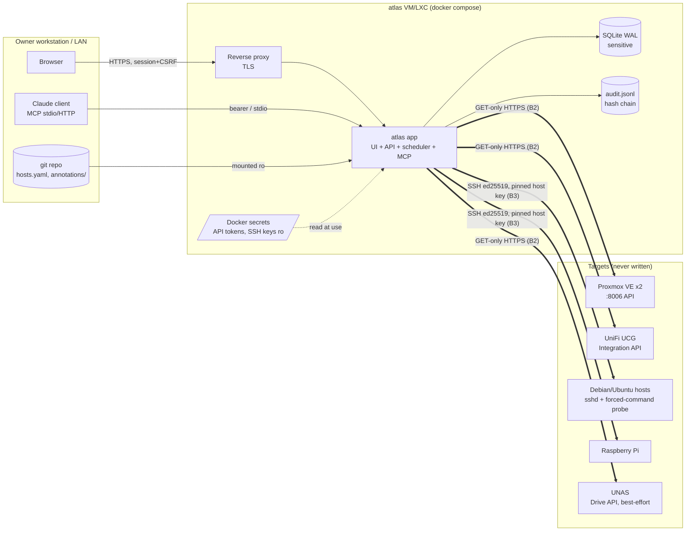
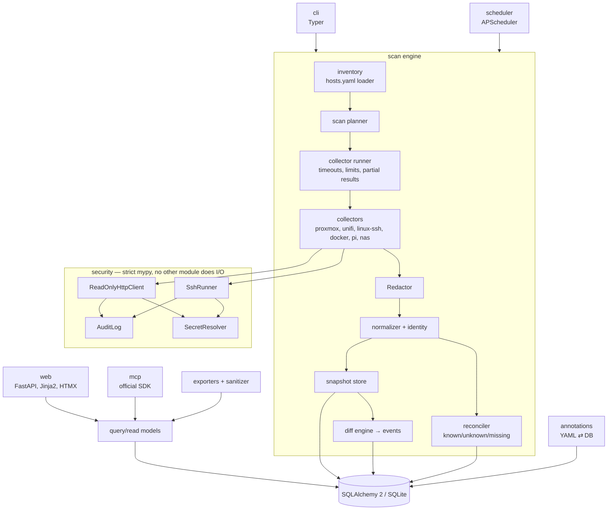
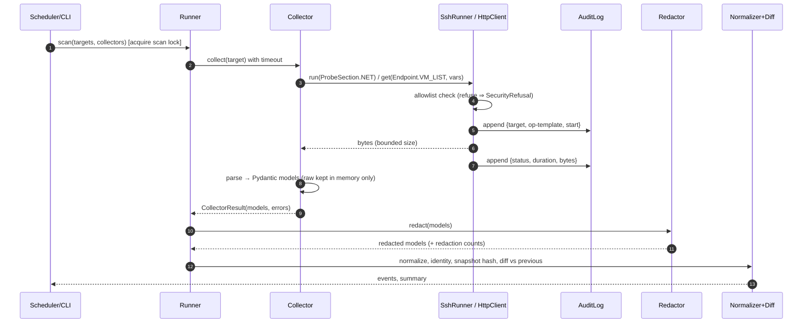
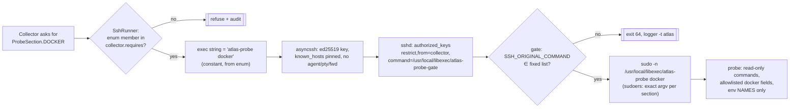
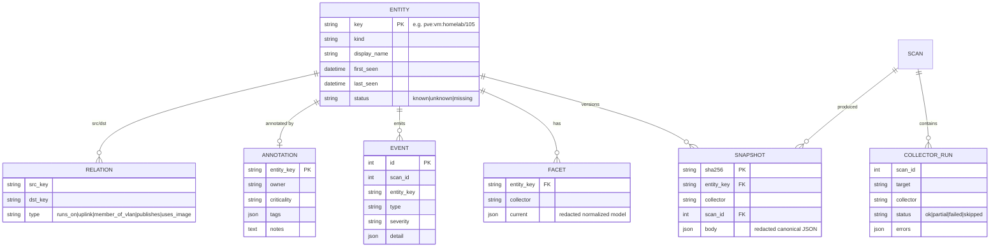
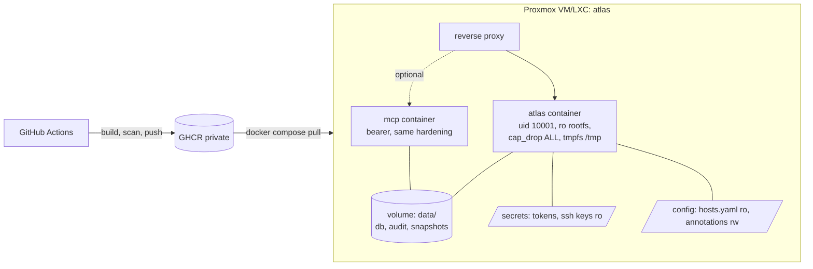

# ARCHITECTURE — Homelab-Docs (`atlas`)

Status: draft for approval (M0a). Rationale lives in DECISIONS.md (ADR-nnn), threats in THREAT-MODEL.md.

## 1. Context and trust boundaries

Boundaries: **B1** user→app (auth), **B2** app→HTTP APIs (ReadOnlyHttpClient), **B3** app→SSH (SshRunner + target-side forced command), **B4** app→storage/exports/MCP (Redactor, sanitize).

## 2. Components


## 3. Scan sequence


## 4. SSH read-only enforcement (defence in depth, ADR-002/003)

The client string is not trusted on the target. The gate ignores everything except an exact match. The probe takes no free-form arguments.

## 5. Data model (simplified)

The Postgres-compatible subset: SQLAlchemy `JSON` type, no SQLite-only SQL, Alembic migrations from day one.

## 6. Repository layout
```
src/homelab_atlas/
  security/    http.py (ReadOnlyHttpClient) ssh.py (SshRunner) allowlist.py audit.py secrets.py
               errors.py selftest.py    <- the only package allowed to import httpx/asyncssh
  redact/      rules.py redactor.py
  models/      pydantic models per domain, volatile()/keyed() markers
  collectors/  base.py probe_session.py proxmox/ unifi/ linux_ssh/ docker/ nas.py pi.py
  probe/       render.py templates/{atlas-probe.sh, atlas-probe-gate.sh}
  engine/      scan.py (orchestration, lock) diff.py events.py reconcile.py
  store/       db.py tables.py retention.py migrations/ (Alembic)
  inventory/   hosts.py annotations.py
  web/         app.py auth.py queries.py topology.py templates/ static/vendor/
  export/      build.py (document + md/mkdocs/json/csv/mermaid) sanitize.py
  mcp_server.py scheduler.py runtime.py lab.py cli.py cli_scan.py cli_web.py cli_export.py
fixtures/demo-lab/  hosts.yaml state-A/ state-B/ annotations/ (recorded probe + API responses)
docs/targets/       generated by `atlas targets render`: probe, gate, sudoers, authorized_keys
tests/              security/ unit/ integration/ web/
Dockerfile docker-compose.yml .github/workflows/{ci,image}.yml
```

## 7. Deployment

The `atlas` service runs the web UI and the scheduler in one process. MCP over HTTP is an optional second service from the same image (`--profile mcp`, bearer token; ADR-023 amends ADR-015). The MCP stdio transport needs no listener: the client runs `docker compose exec -T atlas atlas mcp`. CI builds the image, smoke-tests it under the production hardening flags and gates it on Trivy before pushing to GHCR with an SBOM and provenance (ADR-024). Step by step: [DEPLOY.md](DEPLOY.md).

## 8. Cross-cutting
- **Errors**: `SecurityRefusal` (never retried, always audited), `TargetUnreachable`, `CollectorParseError` (section-level, partial result kept).
- **Logging**: structlog JSON; a redaction processor runs last; no raw payloads at any level.
- **Config**: `atlas.toml` + env (`ATLAS_*`), Pydantic Settings; secrets only via SecretResolver.
- **Time**: UTC everywhere, tz-aware.
